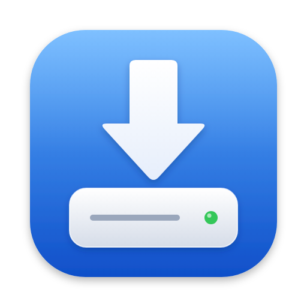
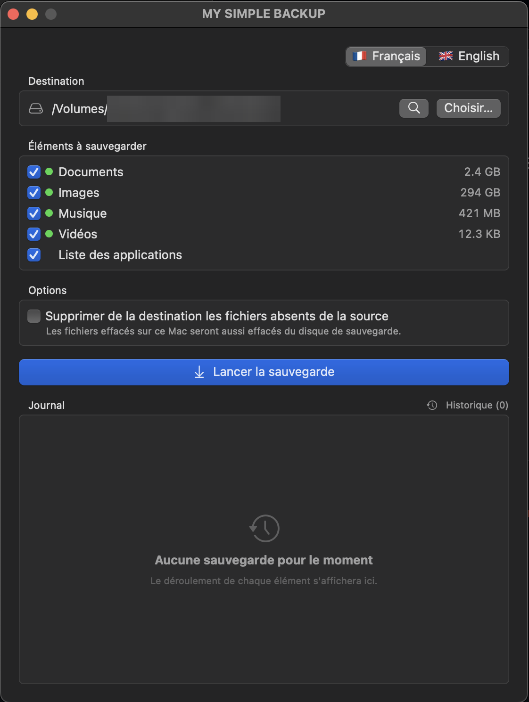
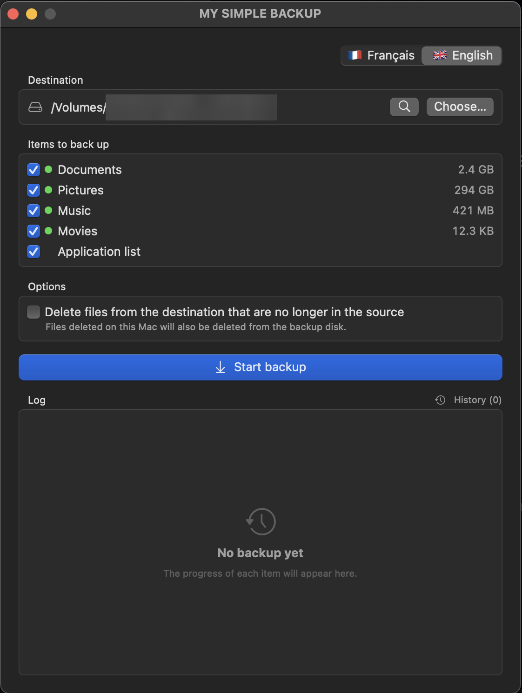

# MY SIMPLE BACKUP



**[Français](#fr)** · **[English](#en)**

---

<a id="fr"></a>

## Français

Application macOS native (SwiftUI, macOS 13 Ventura ou plus récent) qui sauvegarde de façon
incrémentale les dossiers Documents, Images, Musique et Vidéos vers un disque externe, ainsi que
la liste des applications installées. Aucune dépendance : ni Python, ni Homebrew, ni rsync.

*Imaginé à Nantes par DrixLab - Développé par Claude dans les nuages*

- **Copie incrémentale** : seuls les fichiers nouveaux ou modifiés (taille ou date) sont copiés ;
  permissions, dates et attributs étendus (étiquettes Finder…) sont conservés. Chaque fichier est
  écrit dans un fichier temporaire puis renommé : une copie interrompue ne laisse jamais de
  fichier tronqué.
- **Option de suppression** des fichiers absents du Mac, avec garde-fous : rien n'est supprimé
  si un dossier source est illisible ou vide, ni en dehors de la destination.
- **Suivi** : progression en octets, annulation, mise en veille empêchée pendant la sauvegarde,
  avertissement si Photos, Musique ou iMovie sont ouverts ou si l'accès complet au disque manque.
- **Journal et historique** : détail par élément (fichiers copiés, éléments non copiés) et
  historique des sauvegardes passées (⌘Y).
- **Français ou anglais**, au choix dans l'application.

<p align="center"></p>

### Avertissement

L'utilisation de cette application se fait **à vos propres risques et en toute connaissance de
cause**. Le développeur ne pourra en aucun cas être tenu responsable d'une perte de données, ni de
tout autre dommage, direct ou indirect, résultant de son utilisation. Testez-la d'abord sur des
données sans importance, n'activez l'option de suppression qu'en connaissance de cause, et
conservez si possible une autre sauvegarde de vos données importantes (Time Machine, par exemple).

### Compilation

Prérequis : un Mac sous macOS 13 ou plus récent, avec **Xcode 15** ou plus récent. Aucun autre
outil n'est nécessaire.

```bash
git clone https://github.com/DRIXLAB/MY_SIMPLE_BACKUP.git
cd MY_SIMPLE_BACKUP
bash build.sh --open
```

Le script lance les tests, compile avec Swift Package Manager, puis assemble et signe
`dist/MY SIMPLE BACKUP.app`. Options :

| Option | Effet |
|---|---|
| `--install` | Copie l'application dans /Applications |
| `--open` | Lance l'application après la compilation |
| `--debug` | Compilation en mode debug |
| `--skip-tests` | Ne lance pas les tests |

En cas d'échec, les erreurs sont affichées et les journaux complets se trouvent dans `build/`.
Les tests seuls se lancent avec `swift test`.

### Signature et accès complet au disque

L'application doit obtenir l'**accès complet au disque** pour copier la photothèque et les
bibliothèques Musique et iMovie : Réglages Système › Confidentialité et sécurité › Accès complet
au disque → ajouter « MY SIMPLE BACKUP ». L'application affiche un bandeau avec un raccourci vers
ce réglage tant que l'accès n'est pas accordé.

macOS rattache cet accès à la signature de l'application. `build.sh` utilise automatiquement un
certificat « Developer ID Application » ou « Apple Development » présent dans le trousseau (ou
celui indiqué par `SIGN_IDENTITY="…"`) ; sans certificat, l'application est signée localement
et l'accès doit être redonné après chaque compilation. Un certificat gratuit s'obtient dans
Xcode › Réglages › Comptes (ajouter un Apple ID), puis « Gérer les certificats… » › + ›
Apple Development.

### Licence

Ce programme est un logiciel libre distribué sous les termes de la
[licence publique générale GNU, version 3](LICENSE) (GPL-3.0) : vous pouvez le redistribuer
et le modifier selon ces termes. Il est fourni sans aucune garantie.

---

<a id="en"></a>

## English

Native macOS app (SwiftUI, macOS 13 Ventura or later) that incrementally backs up the Documents,
Pictures, Music and Movies folders to an external disk, along with the list of installed
applications. No dependencies: no Python, no Homebrew, no rsync.

*Imagined in Nantes by DrixLab - Developed by Claude in the clouds*

- **Incremental copy**: only new or modified files (size or date) are copied; permissions, dates
  and extended attributes (Finder tags…) are preserved. Each file is written to a temporary file
  and then renamed: an interrupted copy never leaves a truncated file behind.
- **Deletion option** for files no longer on the Mac, with safeguards: nothing is deleted if a
  source folder is unreadable or empty, nor outside the destination.
- **Monitoring**: progress in bytes, cancellation, sleep prevented during the backup, warning if
  Photos, Music or iMovie are open or if Full Disk Access is missing.
- **Log and history**: per-item details (files copied, items not copied) and history of past
  backups (⌘Y).
- **French or English**, selectable in the app.

<p align="center"></p>

### Disclaimer

You use this app **at your own risk and with full knowledge of the consequences**. The developer
cannot be held liable under any circumstances for any data loss, or for any other direct or
indirect damage, resulting from its use. Test it first on unimportant data, only enable the
deletion option if you understand what it does, and whenever possible keep another backup of
your important data (Time Machine, for example).

### Build

Requirements: a Mac running macOS 13 or later, with **Xcode 15** or later. No other tool is
needed.

```bash
git clone https://github.com/DRIXLAB/MY_SIMPLE_BACKUP.git
cd MY_SIMPLE_BACKUP
bash build.sh --open
```

The script runs the tests, builds with Swift Package Manager, then assembles and signs
`dist/MY SIMPLE BACKUP.app`. Options:

| Option | Effect |
|---|---|
| `--install` | Copies the app to /Applications |
| `--open` | Launches the app after the build |
| `--debug` | Debug build |
| `--skip-tests` | Skips the tests |

If the build fails, the errors are displayed and the full logs are in `build/`. Run the tests
alone with `swift test`. The build script's own messages are in French.

### Signing and Full Disk Access

The app needs **Full Disk Access** to copy the Photos library and the Music and iMovie libraries:
System Settings › Privacy & Security › Full Disk Access → add “MY SIMPLE BACKUP”. The app shows a
banner with a shortcut to this setting until access is granted.

macOS ties this access to the app's signature. `build.sh` automatically uses a
“Developer ID Application” or “Apple Development” certificate found in the keychain (or the one
given with `SIGN_IDENTITY="…"`); without a certificate, the app is signed locally and access must
be granted again after each build. A free certificate can be obtained in Xcode › Settings ›
Accounts (add an Apple ID), then “Manage Certificates…” › + › Apple Development.

### License

This program is free software distributed under the terms of the
[GNU General Public License, version 3](LICENSE) (GPL-3.0): you can redistribute it and/or modify
it under these terms. It comes with no warranty.
